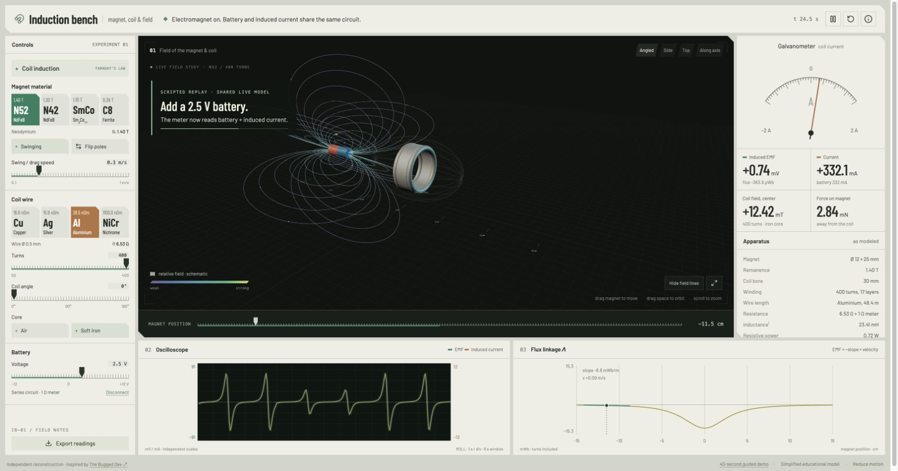

# Induction Bench

An interactive electromagnetic induction workbench built with React, TypeScript and Three.js. Move a magnet through a coil and watch the field illustration, galvanometer, measurements and graphs respond to one deterministic teaching model.

[](https://github.com/JesseQin123/induction-bench/raw/refs/heads/main/docs/media/induction-bench-demo.mp4)

**[Watch / download the demo — 40 seconds, 30 fps, MP4](https://github.com/JesseQin123/induction-bench/raw/refs/heads/main/docs/media/induction-bench-demo.mp4)** · [Recording method](docs/DEMO.md) · [中文简介](#中文简介)

The video captures the actual application with scripted inputs and a fixed simulation clock. Each of its 1,200 frames was rendered and captured separately; no frame interpolation, generated video or fake instrument readings. The application itself is fully interactive.

## Run locally

Requires Node.js 22.12 or newer and npm.

```sh
git clone https://github.com/JesseQin123/induction-bench.git
cd induction-bench
npm ci
npm run dev
```

Open **http://127.0.0.1:5178/**. No account, API key or backend is needed. Fonts are bundled locally; after installing dependencies, the application works without external network requests. `.npmrc` retains the peer-dependency installation mode used by the lockfile.

```sh
npm test          # numerical model and deterministic replay checks
npm run build    # TypeScript checks and production bundle
npm run preview  # serve dist at http://127.0.0.1:4178/
```

If a port is busy, use `npm run dev -- --port 5180`. Serve the production `dist/` folder over HTTP; opening its HTML directly as a file will not load module assets correctly.

## Explore

- Drag the 3D magnet, use the position slider, or start **Swing magnet**. Motion follows the selected speed limit instead of teleporting.
- Flip the poles; select N52, N42, SmCo or ferrite; compare copper, silver, aluminium and nichrome windings.
- Adjust 50–400 turns, 0–180° coil angle, air / soft-iron core and a −12 to +12 V battery.
- Orbit, zoom, or choose one of four camera presets. Pause, reset, hide field lines or reduce decorative motion.
- Read induced EMF, total current, estimated central field and force. The scope plots induced voltage/current; the flux plot shows the same model's linkage and tangent.
- Export the last eight simulation seconds to CSV: up to 240 samples, 30 Hz, SI units.
- Tab to controls and use arrow keys on sliders. With the 3D scene focused, ← / → moves the magnet, Space pauses and R resets. The information dialog closes with Escape. Phone and tablet layouts rearrange the instrument panels.

Use the **40-second guided demo** link in the footer to replay the video sequence live. Clicking an experiment control, or using its keyboard controls, returns to normal interaction.

## The model and its limits

This is a **simplified, quasi-static educational model**, not a real engineering field solver. `src/model.ts` owns all numerical results. The simulation uses a fixed 1/120-second step and samples its graphs at 30 Hz.

For pole sign `s`, turns `N`, remanence `Br`, core factor `k` (air: 1; iron: 3), angle `θ` and position `x` in metres:

```text
Λ(x) = s N Br (7 × 10⁻⁶) k cos(θ) / [1 + (x/0.038)²]^(3/2)
∂Λ/∂x = Λ(x) × −3x / (0.038² + x²)
EMF = −(∂Λ/∂x) v
I = (Vbattery + EMF) / (Rwire + 1 Ω)
F = I × (∂Λ/∂x)
```

Wire resistance uses resistivity, estimated winding length and cross-sectional area. The analog meter saturates at ±2 A with an explicit over-range label; the digital reading remains available. Scope channels have independent labeled scales. The total-current meter includes the battery; the scope's induced-current trace does not.

The coupling envelope is selected for clear teaching, not fitted to a measured magnet. Motion is prescribed; the displayed force does not accelerate it. Parameter edits are quasi-static and do not produce parameter-change transients. There is no RL transient solution, heating, hysteresis, saturation, skin effect or eddy-current simulation. Inductance is a static estimate. Field lines are procedural illustrations, not integrated streamlines of a solved combined field. Visible winding loops represent groups of physical turns; 3D dimensions are exaggerated for readability.

## Inspiration and licensing

Inspired by [The Bugged Dev's Induction bench](https://x.com/thebuggeddev/status/2104402407358919124), featured in [Claude's showcase](https://x.com/claudeai/status/2111177840326832573) and [project collection](https://x.com/claudeai/status/2111177834127601902). Reference frames were inspected to guide the instrument-panel composition. This is an independent implementation with original application code and procedural geometry; the reference screenshots, video and original application assets are not distributed here.

This project is **not affiliated with, authorized by, or endorsed by The Bugged Dev, Anthropic or Claude**. It does not claim pixel-perfect equivalence or the original application's internal physics. See [reference differences](docs/REFERENCE-DIFFERENCES.md).

Original code, documentation and recordings of this implementation are available under [MIT](LICENSE). Bundled Barlow fonts retain their [SIL Open Font License](public/fonts/OFL.txt). Dependencies retain their own licenses; see [third-party notices](THIRD_PARTY_NOTICES.md).

## 中文简介

一个可实际操作的电磁感应实验台：拖动或摆动磁铁，观察电表、感应电压、电流、磁通与示波器同步变化。支持磁极翻转、四种磁铁和导线、匝数、线圈角度、铁芯、电池、CSV 导出、键盘操作及减少动效。

按上方命令安装并启动，打开 `http://127.0.0.1:5178/`。页脚的 **40-second guided demo** 可在网页中重放演示；点击任一实验控件即可接管操作。视频为 40 秒、30 fps 的真实网页逐帧采集，使用确定性脚本输入，不是旧视频插帧或生成式视频。

这是简化的准静态教学模型，不是工程电磁求解器。实现受 The Bugged Dev 的演示启发，代码与几何独立编写，不代表原作者授权或官方合作。项目采用 MIT 许可证，字体另遵循 OFL。
